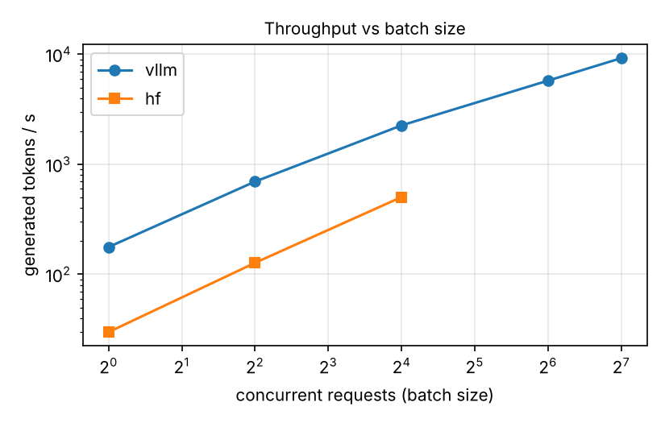

# LLM Inference Benchmarks

Measured, reproducible experiments on what makes model inference fast or slow on a GPU, from
single kernels up to serving a language model. Each experiment is a command that writes a
JSON result (with GPU, library versions and git commit), and one command turns them all into
a report.

| Experiment | Question it answers | Command |
| --- | --- | --- |
| Roofline | Why is a matrix multiply limited by compute, but an add by memory bandwidth? | `python -m infbench.roofline` |
| Profiling | Where does the time go in a training step, and what does a CPU–GPU sync cost? | `python -m infbench.profiling` |
| Triton kernels | Can I write a correct GPU kernel, and does fusing two operations save time? | `python -m infbench.triton_kernels` |
| JAX sharding | When does splitting a matmul across devices require communication? | `python -m infbench.jax_sharding` |
| LLM serving | How much faster is vLLM than plain Hugging Face, and what does batching cost in latency? | `python -m infbench.serving` |

## Results

**Key findings** (one NVIDIA T4, November 2026):

- **Compute vs memory.** A large matrix multiply reached 23.1 TFLOPS, while an element-wise add was capped at 247 GB/s, about 77% of the T4's ~320 GB/s memory bandwidth. The add does under 0.2 operations per byte moved, so memory, not maths, sets its speed.
- **Profiling.** Matrix-multiply kernels took 74.7% of GPU time in an MLP training step; most of the rest was the optimizer's weight update, which is large at a small batch size. Calling `.item()` every step raised CPU loop time from 2.6 ms to 11.6 ms (4.5×), because each call forces the CPU to wait for the GPU.
- **Triton.** Both kernels matched PyTorch on all six sizes, including partial last blocks. A plain Triton add tied PyTorch (both at memory bandwidth), while fusing add + ReLU into one kernel was 1.66× faster than PyTorch's two separate operations, because the intermediate result never goes back to memory.
- **JAX sharding.** Splitting the batch dimension needed no communication; splitting the summed-over (contraction) dimension made XLA insert an all-reduce, and both versions matched the unsharded result.
- **LLM serving.** vLLM served Qwen2.5-0.5B at 9,226 tokens/s with 128 concurrent requests, 52× its single-request throughput, while batch latency rose only from 0.72 s to 1.78 s. It was 4.5–5.9× faster than Hugging Face at the same batch sizes. Under identical greedy settings the first 32 tokens matched for 100% of requests (117–128 of 128 tokens on average).
- **A bug the checks caught.** The first serving run showed 0% token agreement. The cause was Hugging Face silently applying the model's default repetition penalty; after aligning the decoding settings the outputs matched, and a test now guards against it.

### Compute-bound vs memory-bound

| Operation | Size | Result | Arithmetic intensity (FLOP/byte) |
| --- | --- | --- | --- |
| matmul | 512 | 5.2 TFLOPS | 171 |
| matmul | 1024 | 16.6 TFLOPS | 341 |
| matmul | 2048 | 23.1 TFLOPS | 683 |
| matmul | 4096 | 22.4 TFLOPS | 1.37e+03 |
| add | 50000000 | 247 GB/s | 0.167 |

### Profiling

Top GPU kernels by self time in an MLP training step:

- 28.6% volta_sgemm_128x64_tn
- 26.7% volta_sgemm_128x64_nt
- 23.8% void at::native::(anonymous namespace)::multi_tensor_apply_kernel<at::native::(a
- 19.4% volta_sgemm_128x64_nn
- 0.4% void at::native::reduce_kernel<512, 1, at::native::ReduceOp<float, at::native::M

Matrix-multiply kernels: 74.7% of measured time.

Calling `.item()` every step changed CPU loop time from 2.6 ms to 11.6 ms over 10 steps.

### Triton kernels

Correct on all 6 test sizes (including partial last blocks): yes.

| Kernel | Time (ms) |
| --- | --- |
| PyTorch add | 2.463 |
| Triton add | 2.502 |
| PyTorch add, then ReLU | 4.140 |
| Triton fused add + ReLU | 2.488 |

Fusion speed-up: 1.66×. Triton add bandwidth: 240 GB/s.

### JAX sharding on a 4 × 2 device mesh

| Sharded dimension | Communication in compiled program | Matches unsharded |
| --- | --- | --- |
| batch | none | True |
| contraction | all-reduce | True |

### LLM serving: vLLM vs Hugging Face

Model `Qwen/Qwen2.5-0.5B-Instruct`, greedy decoding, 128 generated tokens per request.

| Backend | Batch | Tokens/s | Batch latency (s) |
| --- | --- | --- | --- |
| vllm | 1 | 177 | 0.72 |
| vllm | 4 | 697 | 0.73 |
| vllm | 16 | 2259 | 0.91 |
| vllm | 64 | 5763 | 1.42 |
| vllm | 128 | 9226 | 1.78 |
| hf | 1 | 30 | 4.29 |
| hf | 4 | 127 | 4.02 |
| hf | 16 | 504 | 4.06 |

| Batch | vLLM speed-up over HF | First-32-token match rate | Mean matching prefix (tokens) |
| --- | --- | --- | --- |
| 1 | 5.9× | 100% | 128 of 128 |
| 4 | 5.5× | 100% | 117 of 128 |
| 16 | 4.5× | 100% | 124 of 128 |

vLLM throughput rose 52× from batch 1 to 128, while batch latency rose from 0.72 s to 1.78 s.



### Environment

GPU: Tesla T4 · PyTorch 2.11.0+cu130 · CUDA 13.0 · commit 16d9b49 · 2026-11-14T11:48:52Z

## How each experiment is made trustworthy

- **Correct before fast.** Triton kernels are checked against PyTorch with `torch.allclose` on
  awkward sizes (1, 1,023, 1,025, 1,000,003) that exercise the masked last block, before any
  timing. vLLM and Hugging Face outputs are compared token by token under greedy decoding.
- **Fair comparisons.** Every serving request generates exactly the same number of tokens
  (end-of-sequence ignored), with the same prompts, model and precision for both backends.
- **Honest timing.** GPU work is asynchronous, so timers synchronise the GPU before reading
  the clock; warm-up runs are excluded; the median of repeated runs is reported.
- **Reproducible.** Every result file records the GPU, PyTorch, CUDA and git commit.
- **Tested.** 13 CPU tests run in CI, including the real Triton kernels in Triton's interpreter
  mode and the JAX sharding check on 8 simulated devices.

## Reproduce

```bash
git clone https://github.com/Bukola-Baiyewu1/llm-inference-benchmarks.git
cd llm-inference-benchmarks
pip install -e ".[dev]"
pytest -q                                   # CPU tests, no GPU needed
python -m infbench.roofline
python -m infbench.profiling
python -m infbench.triton_kernels           # needs a CUDA GPU
python -m infbench.jax_sharding             # CPU is fine (simulates 8 devices)
pip install -e ".[serving]"
python -m infbench.serving --backend vllm --batches 1 4 16 64 128 --out results/serving_vllm.json
python -m infbench.serving --backend hf --batches 1 4 16 --out results/serving_hf.json
python -m infbench.report                   # writes results/summary.md and throughput.png
```

Tested on Google Colab with an NVIDIA T4 (16 GB). The T4 has no bfloat16 support, so the
serving benchmark uses float16 (`--dtype half`).

## Limitations

- One small model (Qwen2.5-0.5B-Instruct) on one GPU type; numbers will differ on other hardware.
- Offline batch serving only: latency is measured per batch, not per streamed token under live traffic.
- The JAX experiment simulates devices on a CPU: it shows *where* communication happens, not how long it takes on real TPUs.
