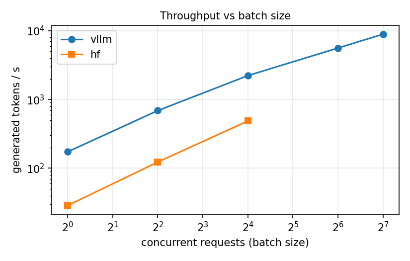

# Results

## LLM serving: vLLM vs Hugging Face

Model `Qwen/Qwen2.5-0.5B-Instruct`, greedy decoding, 128 generated tokens per request.

| Backend | Batch | Tokens/s | Batch latency (s) |
| --- | --- | --- | --- |
| vllm | 1 | 174 | 0.74 |
| vllm | 4 | 690 | 0.74 |
| vllm | 16 | 2226 | 0.92 |
| vllm | 64 | 5609 | 1.46 |
| vllm | 128 | 8915 | 1.84 |
| hf | 1 | 29 | 4.46 |
| hf | 4 | 123 | 4.15 |
| hf | 16 | 488 | 4.20 |

| Batch | vLLM speed-up over HF | First-32-token match rate | Mean matching prefix (tokens) |
| --- | --- | --- | --- |
| 1 | 6.0× | 100% | 128 of 128 |
| 4 | 5.6× | 100% | 117 of 128 |
| 16 | 4.6× | 100% | 117 of 128 |

vLLM throughput rose 51× from batch 1 to 128, while batch latency rose from 0.74 s to 1.84 s.

## Environment

GPU: Tesla T4 · PyTorch 2.11.0+cu130 · CUDA 13.0 · commit 2d19dce · 2026-11-14T10:42:03Z
